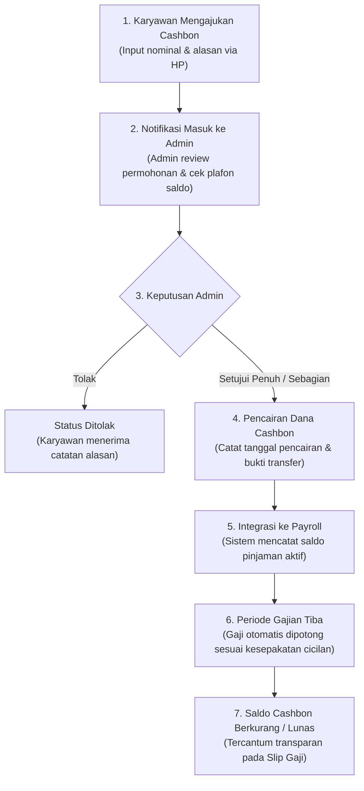

# Analisis Kebutuhan & Ide Sistem (PAYROLLKU)

Dokumen ini disusun berdasarkan hasil telaah terhadap berkas ide, spesifikasi fitur, dan alur kerja (workflow) pada folder `scratch/` (`ide1.jpeg`, `ide2.jpeg`, `spek1.jpeg`, `spek2.jpeg`, dan `flow casbon.jpeg`).

---

## 1. Ringkasan Visi & Konsep Produk

* **Nama Konsep:** PAYROLLKU (Employee & Salary Management)
* **Tagline:** *"Kelola gaji dan cashbon karyawan dalam satu tempat."*
* **Target Pengguna:**
  1. **Administrator / HR / Finansial:** Mengelola data master karyawan, memproses persetujuan cashbon, menjalankan penggajian, dan mengunduh laporan keuangan.
  2. **Karyawan:** Mengakses portal lewat smartphone untuk absensi, melihat slip gaji, mengajukan pinjaman/cashbon mandiri, dan memantau status persetujuan serta sisa saldo cashbon.

---

## 2. Analisis Kesenjangan (Gap Analysis)

Membandingkan sistem **Fermi Payroll** yang sudah berjalan saat ini dengan kebutuhan baru dari klien:

| Area / Fitur | Kondisi Sistem Saat Ini | Kebutuhan Baru Klien | Catatan Tindak Lanjut IT |
| :--- | :--- | :--- | :--- |
| **Cashbon (Kasbon)** | Belum ada | Modul pengajuan dari HP karyawan, verifikasi plafon/saldo, approval admin, pencairan bertahap, dan pemotongan otomatis saat gajian | Perlu tabel baru `cashbon_requests` & `cashbon_transactions` |
| **Data Karyawan** | NIK, Nama, No. HP, Tanggal Masuk, Skema Gaji, Tarif, Jadwal Gajian | Tambahan: Jabatan, No. Rekening Bank/E-Wallet, Tunjangan Tetap | Penambahan kolom pada tabel `employees` |
| **Komponen Payroll** | Perhitungan unit (jam/hari/minggu/bulan) dikali tarif dasar | Tambahan: Gaji pokok, tunjangan, lembur, bonus, potongan cashbon, potongan lain, gaji bersih | Penambahan breakdown kalkulasi slip & settlement |
| **Cetak Slip Gaji** | Tampilan web ringkas | Cetak slip gaji format resmi (PDF / Print View rapi) | Pembuatan template slip cetak/PDF |
| **Dashboard Admin** | Ringkasan absensi hari ini & tagihan aktif | Ringkasan Keuangan: Total Gaji Pokok, Total Cashbon Diajukan, Status Persetujuan, dan Tombol Akses Cepat | Update widget cards & quick actions |
| **Riwayat Transaksi** | Riwayat pelunasan gaji (`payroll_settlements`) | Audit log lengkap: pencairan cashbon, potongan gaji, pembatalan, aktor pengubah (siapa & kapan) | Tabel log transaksi / audit trail |
| **Laporan & Ekspor** | Tampilan tabel web | Rekap gaji & cashbon per bulan, per karyawan, filter cabang, ekspor Excel (XLSX/CSV) & PDF | Integrasi parser ekspor laporan |

---

## 3. Rincian Kebutuhan Fitur (7 Modul Utama)

### Modul 1: Dashboard & Ringkasan Keuangan
* **Kartu Ringkasan:**
  * Total Karyawan aktif
  * Total Gaji Pokok berjalan bulan ini
  * Total Cashbon yang sedang diajukan
  * Status Cashbon (jumlah yang disetujui / pending)
* **Tombol Akses Cepat (Quick Actions):**
  * `+ Tambah Karyawan`
  * `+ Input Cashbon` (Admin input manual bila ada pengajuan offline)
  * `Kelola Penggajian` (Akses langsung ke batch bayar / settlement)

### Modul 2: Data Karyawan
* Informasi karyawan yang wajib tercatat:
  * Nama Lengkap & ID Karyawan (NIK)
  * Jabatan / Posisi
  * Nomor HP / WhatsApp
  * Tanggal Masuk (Join Date)
  * Status Keaktifan (Aktif / Nonaktif)
  * Gaji Pokok & Tunjangan Tetap
  * Informasi Rekening Bank / E-Wallet untuk pencairan gaji
* Operasi CRUD lengkap (Tambah, Edit, Nonaktifkan, Aktifkan kembali, Hapus permanen, serta pembuatan akun login).

### Modul 3: Payroll / Penggajian
* Perhitungan gaji berbasis komponen:
  * **Pendapatan (+):** Gaji Pokok + Tunjangan + Upah Lembur + Bonus Kehadiran/Performa.
  * **Potongan (-):** Potongan Keterlambatan/Absen + Cicilan Potongan Cashbon + Potongan Lainnya.
  * **Gaji Bersih (Take Home Pay):** Total Pendapatan dikurangi Total Potongan.
* Status pembayaran tagihan (Belum Dibayar / Sudah Terbayar).
* Fitur Cetak Slip Gaji yang informatif untuk karyawan.

### Modul 4: Cashbon (Pinjaman Karyawan)
* Karyawan dapat mengajukan permohonan pinjaman langsung dari HP.
* Admin meninjau permohonan dengan acuan limit/plafon gaji berjalan.
* Opsi keputusan admin:
  * Disetujui Penuh (Full Approved)
  * Disetujui Sebagian (Partial Approved dengan penyesuaian nominal)
  * Ditolak (Rejected disertai catatan alasan)
* Pencatatan tanggal realisasi pencairan dana.
* Saldo sisa pinjaman otomatis berkurang ketika dipotong pada siklus penggajian.

### Modul 5: Riwayat Transaksi & Audit Trail
* Mencatat rekam jejak setiap aksi finansial:
  * Pencairan cashbon
  * Pembayaran gaji
  * Pemotongan angsuran
  * Pembatalan transaksi
* Menyimpan metadata: *Waktu kejadian (timestamp)*, *Nominal*, *Karyawan terkait*, dan *Nama admin penanggung jawab*.

### Modul 6: Laporan & Ekspor Data
* Rekapitulasi pengeluaran gaji dan pencairan cashbon berkala (bulanan/tahunan).
* Pengelompokan berdasarkan periode, nama karyawan, dan departemen/cabang.
* Fitur unduh laporan dalam format **Excel (.xlsx/.csv)** dan **PDF**.

### Modul 7: Portal Karyawan Mobile
* Antarmuka responsif ramah smartphone untuk karyawan:
  * Dashboard personal (ringkasan status absensi & gaji berjalan).
  * Form pengajuan cashbon baru (nominal & alasan kebutuhan mendesak).
  * Pemantau status pengajuan (Menunggu Persetujuan / Disetujui / Ditolak).
  * Riwayat penerimaan gaji dan unduh slip gaji mandiri.

---

## 4. Alur Kerja (Workflow) Cashbon

Berikut diagram alur proses pengajuan dan pemotongan cashbon sesuai arahan klien:

---

## 5. Rekomendasi Skema Database (Penyesuaian Teknis)

Untuk mengimplementasikan fitur tersebut tanpa merusak sistem presensi dan payroll yang sudah aktif, disarankan penambahan tabel dan kolom berikut:

### 1. Kolom Tambahan pada Tabel `employees`
* `position` (VARCHAR 100) — Jabatan karyawan
* `bank_name` (VARCHAR 50) — Nama bank (BCA, Mandiri, BRI, dll)
* `bank_account_number` (VARCHAR 50) — Nomor rekening
* `bank_account_holder` (VARCHAR 100) — Nama pemilik rekening
* `fixed_allowance` (DECIMAL 15,2) — Tunjangan tetap bulanan

### 2. Tabel Baru: `cashbon_requests`
Menyimpan riwayat pengajuan pinjaman karyawan:
* `id` (INT PK Auto Increment)
* `employee_id` (INT FK -> employees.id)
* `amount_requested` (DECIMAL 15,2) — Nominal diajukan
* `amount_approved` (DECIMAL 15,2) — Nominal disetujui admin
* `reason` (TEXT) — Alasan pinjaman
* `status` (ENUM: `pending`, `approved`, `partial`, `rejected`, `settled`)
* `disbursed_at` (DATETIME NULL) — Waktu uang dicairkan ke karyawan
* `admin_notes` (TEXT NULL) — Catatan dari admin
* `approved_by` (INT FK -> users.id)
* `created_at` (TIMESTAMP)

### 3. Tabel Baru: `cashbon_repayments`
Menyimpan riwayat pemotongan pinjaman:
* `id` (INT PK Auto Increment)
* `cashbon_id` (INT FK -> cashbon_requests.id)
* `settlement_id` (INT NULL FK -> payroll_settlements.id)
* `amount` (DECIMAL 15,2) — Nominal yang dipotong
* `repaid_at` (DATETIME)
* `notes` (VARCHAR 255)

---

## 6. Rencana Tahapan Eksekusi (Roadmap IT)

1. **Fase 1 (Skema Database & Pengayaan Profil Karyawan):**
   * Migrasi penambahan kolom jabatan dan rekening pada data master karyawan.
2. **Fase 2 (Modul Cashbon Backend & Admin Portal):**
   * Pembuatan tabel pengajuan cashbon.
   * Halaman kelola cashbon untuk admin (daftar pengajuan, aksi approve/reject, pencatatan pencairan).
3. **Fase 3 (Portal Karyawan Pengajuan Cashbon):**
   * Menambahkan menu form pengajuan cashbon di portal karyawan mobile (`/karyawan/cashbon`).
4. **Fase 4 (Koneksi Otomatis ke Payroll & Cetak Slip):**
   * Menghubungkan pemotongan cashbon langsung ke formula perhitungan `admin/payroll`.
   * Template cetak slip gaji lengkap dengan rincian pendapatan dan potongan cashbon.
5. **Fase 5 (Laporan & Riwayat Transaksi):**
   * Halaman ekspor laporan bulanan ke Excel/PDF dan log riwayat transaksi.
